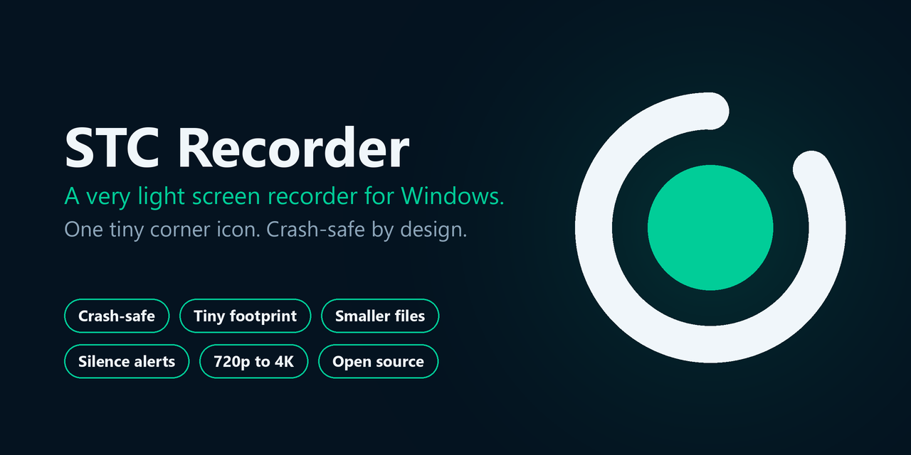
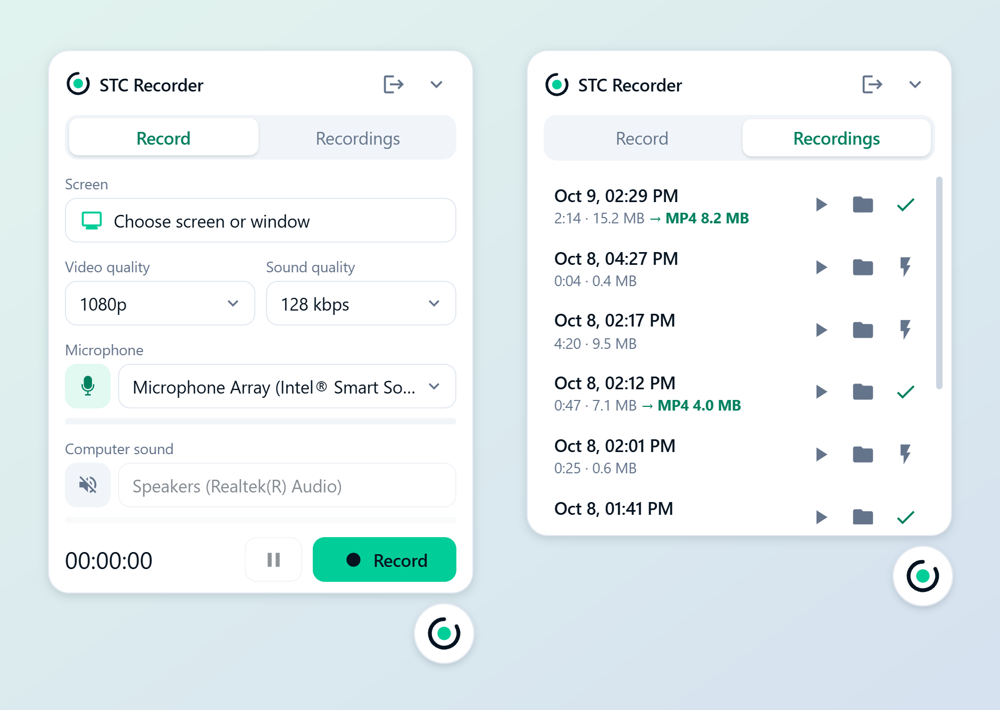

<p align="center">
  
</p>

# STC Recorder

A very light, open-source screen recorder for Windows. It lives as one small round icon in the corner of your
screen. Click it, a panel slides out, press **Record**. If the app, Windows or the power dies in the middle of a
recording, you keep everything up to the last few seconds.

Built with Electron. Free, no account, no cloud, no watermark, no telemetry.

<p align="center">
  
</p>

## Download

**[Download the latest release (Windows installer)](https://github.com/sarabh83/recorder/releases/latest)**

Run `STC-Recorder-Setup-<version>.exe`. It installs per user, no admin rights needed.

## Features

### Light and out of the way
- A single 44 px corner icon instead of a window. The panel slides out on click and gets out of the way when
  recording starts. Drag the icon anywhere; it remembers its place.
- While recording, the icon turns green with a live level halo, and the time so far appears beside it.
- Uses the lightest codec by default (VP8) at 24 to 30 fps. H.264 is available if you prefer GPU encoding.
- Optional **Hide icon while recording**, and a global shortcut `Ctrl+Shift+R` to start/stop.

### It never records itself
The icon, the panel, the source picker and the area border are excluded from capture using Windows content
protection, so they never show up in your video.

### Crash-safe recordings
- Video is written to disk continuously, in 1-second chunks, and forced to the physical disk every 5 seconds.
- Extra flushes on system suspend, lock screen and Windows shutdown.
- A journal with checkpoints is kept next to every recording.
- A recording that was cut off by a crash or a power loss is not lost. It appears in the **Recordings** tab, marked
  *interrupted*, and plays normally.

### Smaller files
- **Final processing** re-encodes any recording to a compact `recording.mp4` (x264, CRF 20, AAC, fast-start) using
  the bundled ffmpeg. Bits are spent only where the picture needs them, so screen recordings usually shrink a lot
  with no visible loss. The original is kept.
- The picture is never scaled up, only capped at the chosen height, and text stays sharp (the encoder drops frames
  before it drops resolution).

### Warns you when something is wrong
- If the sound you are watching is silent for 15 seconds, the icon turns yellow and a small tooltip tells you which
  one (*Microphone muted* or *No computer sound*). Press **OK** if the silence is on purpose and the reminder is
  turned off for the rest of that recording.
- Tells you which microphone is really in use, and says so when the chosen one is gone and the default is used
  instead.
- Warns when the chosen window or screen disappears, or when no computer audio is available for a source.
- The check is level based, not speech detection.

### Pick what you record
- Any **screen or window**, with live thumbnails.
- **Select an area**: drag a rectangle over part of a screen. A dashed green border marks it, and turns solid while
  recording.

### Choose your quality
| Video | Presets |
|---|---|
| Resolution and bitrate | 720p, 1080p, 1080p High, 1440p, 4K |
| Frame rate | 15, 24, 30 fps |
| Codec | VP8 (lightest on CPU), H.264 |

Audio: 64, 128, 192 or 256 kbps.

### Sound done right
- **Microphone** and **computer sound** each have their own row, mute switch and level meter.
- Both are always captured, so either one can be muted or unmuted, and the microphone can be switched, **in the
  middle of a recording**.
- A limiter on the mix prevents clipping when a guest or a video is loud.
- Optional separate `audio.webm` with the same sound, as an independent backup.
- Optional microphone noise suppression. Echo cancellation is applied automatically only when computer sound is on.

### Recordings library
Every recording on disk in one tab: play, open its folder, run final processing (with progress), see size and
duration. Pause and resume while recording.

## Where files go

```
Videos\Starecorder\<date-time>\
    recording.webm     the full video (VP8/H.264 + Opus)
    audio.webm         same sound, audio only (optional)
    recording.mp4      after "final processing"
    journal.json       checkpoints, used to recover interrupted recordings
```

(The folder keeps the app's old name, Starecorder, so recordings made before the rename are still found.)

## Tips for good audio
- **Bluetooth headsets (AirPods):** Windows drops them to phone quality when they are used as a microphone. Use a
  wired/USB or the laptop mic for recording and keep the headset for listening.
- **Computer sound** is whatever Windows' default *output* device is. The panel shows its name; click it to open
  Windows sound settings.

## Tray menu
Start/stop, a *Bootcamp* preset (mic + system audio, 24 fps, 5 Mbps), frame rate, codec, separate audio file, hide
icon while recording, noise suppression, open the recordings folder, quit.

## Develop

Requires Node.js 22 and Windows (screen and system-audio capture use Windows loopback).

```
npm install
npm start        # run (from a VS Code terminal, clear ELECTRON_RUN_AS_NODE first)
npm test         # unit tests
npm run dist     # Windows installer (NSIS) in dist/
python3 scripts/make-icons.py   # regenerate the icons from design/logo.svg (needs Pillow)
```

Project layout:

```
src/main/        main process: window, tray, recording storage (crash-safe writer), library + ffmpeg, settings
src/renderer/    the icon / panel UI, picker, area selection, recorder, silence detector
test/            unit tests (node --test)
design/logo.svg  logo master
```

A GitHub Actions workflow builds the installer on every push.

## Contributing

Issues and pull requests are welcome. Please run `npm test` before opening a PR.

## License

[MIT](LICENSE) © 2026 Taha Hosseinpour
